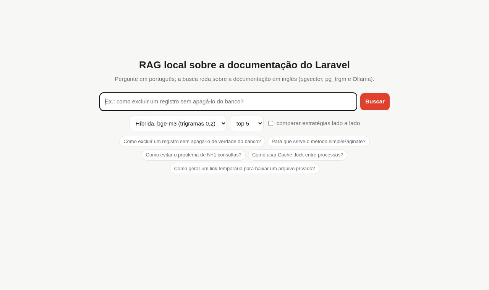
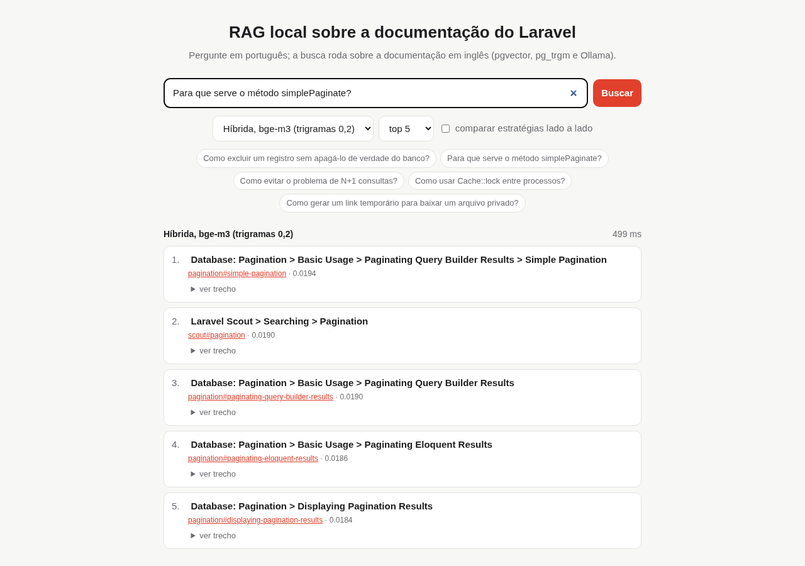
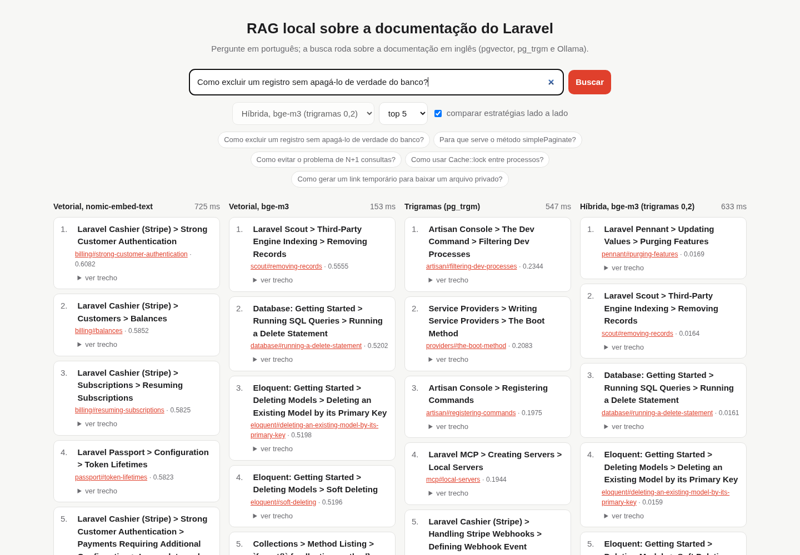

# RAG local sobre a documentação do Laravel

Perguntas em português sobre a documentação oficial do Laravel (em inglês), respondidas a
partir dos trechos certos e com o link da seção. Tudo roda localmente e de graça: PostgreSQL
com **pgvector** e **pg_trgm**, embeddings e modelo de linguagem pelo **Ollama**.

O foco do projeto é medir: cada etapa tem avaliação com perguntas de resposta conhecida.

## Etapas

| Etapa | O que faz | Situação |
|---|---|---|
| 1. Chunking | Quebra cada página por seção (`##`, `###`, `####`), guarda o caminho de títulos, a âncora e a URL, e nunca corta bloco de código | ✅ feito, com testes |
| 2. Embeddings | Gera vetores dos trechos com modelos do Ollama e grava no pgvector | ✅ feito (nomic-embed-text e bge-m3) |
| 3. Busca | Vetorial, por trigramas (pg_trgm) e híbrida (as duas combinadas) | ✅ feito |
| 4. Avaliação da busca | ~30 perguntas em português com a seção esperada; mede se ela aparece entre os 5 primeiros (recall@5) e a posição (MRR) | ✅ primeira rodada |
| 5. Geração | Responde só com os trechos encontrados e cita a seção; o código confere se a citação existe | ✅ feito (qwen2.5:7b) |

Perguntas que a avaliação quer responder:

- Pergunta em português sobre texto em inglês: quanto um modelo de embedding multilíngue ganha de um modelo só em inglês?
- Nomes de método (`simplePaginate`, `Queue::failing`): a busca por trigramas acerta onde a vetorial erra?
- A busca híbrida vale a complexidade a mais?

## Resultados da busca

30 perguntas em português sobre a documentação do Laravel 13.x (19 conceituais, 11 com nome de
método ou classe), 4.128 trechos de 102 páginas. Recall@5: a seção certa aparece entre os 5
primeiros resultados. MRR: média de 1/posição do primeiro acerto.

| Estratégia | Recall@5 geral | Conceito | Nome de método | MRR | Latência mediana |
|---|---|---|---|---|---|
| Vetorial, nomic-embed-text (inglês) | 43% | 21% | 82% | 0,30 | 63 ms |
| Vetorial, bge-m3 (multilíngue) | **87%** | **84%** | 91% | **0,69** | 86 ms |
| Trigramas (pg_trgm) | 53% | 32% | 91% | 0,35 | 562 ms |
| Híbrida (RRF), nomic | 57% | 32% | 100% | 0,46 | 646 ms |
| Híbrida (RRF), bge-m3 | 73% | 58% | 100% | 0,55 | 566 ms |

O que os números dizem até aqui:

- **O modelo multilíngue é o que mais pesa.** Com pergunta em português e documentação em inglês,
  o bge-m3 sobe o acerto nas perguntas conceituais de 21% para 84%.
- **A busca híbrida com pesos iguais ajuda o modelo fraco e atrapalha o forte.** Com o nomic, ela
  sobe o recall de 43% para 57%. Com o bge-m3, cai de 87% para 73%: nas perguntas conceituais,
  os trigramas trazem ruído (palavras em português contra texto em inglês) e empurram a seção
  certa para baixo. Em compensação, a híbrida acerta 100% das perguntas com nome de método.

### Peso menor para os trigramas

O RRF passou a aceitar um peso por lista (`peso / (60 + posição)`). Com o bge-m3, variando o
peso dos trigramas:

| Peso dos trigramas | Recall@5 geral | Conceito | Nome de método | MRR |
|---|---|---|---|---|
| (só vetorial) | 87% | 84% | 91% | 0,69 |
| 1,0 | 73% | 58% | 100% | 0,55 |
| 0,5 | 77% | 63% | 100% | 0,56 |
| 0,3 | 83% | 74% | 100% | 0,60 |
| **0,2** | **90%** | **84%** | **100%** | 0,64 |
| 0,1 | 90% | 84% | 100% | 0,66 |

Com peso 0,2, a híbrida mantém o acerto conceitual da vetorial e ainda acerta todas as perguntas
com nome de método. O MRR fica um pouco abaixo da vetorial pura (0,64 contra 0,69): os trigramas
às vezes empurram a seção certa do 1º para o 2º lugar.

Cuidado com a leitura: são só 30 perguntas (cada uma vale 3,3 pontos) e o peso foi escolhido
olhando para elas mesmas. Para confirmar, o certo é testar com perguntas novas, que não serviram
para escolher o peso.

Os resultados completos de cada rodada ficam em `evals/resultados/`.

Rodada de conferência (12/11, banco e índices HNSW recriados do zero): as buscas vetoriais e por
trigramas repetiram os números acima; a híbrida variou um pouco para cima (pesos iguais 77%, peso
0,2 com 93% no geral e 89% no conceito), efeito do índice aproximado. A geração repetiu 100% de
respostas com citação, 89% citando a seção certa e 15 s por resposta.

### Correção do gabarito

Na primeira rodada (só nomic e trigramas), três "erros" eram seções corretas que o gabarito não
listava. Elas foram aceitas como resposta antes da rodada com o bge-m3, e a rodada do nomic foi
refeita com o mesmo gabarito:

- pergunta 20 (Cache::lock): `cache#managing-locks-across-processes`
- pergunta 26 (tokens para app mobile): `sanctum#issuing-mobile-api-tokens`
- pergunta 28 (Http::pool): `http-client#request-pooling`

Com o gabarito antigo, o nomic tinha 40% (vetorial) e 50% (híbrida); com o novo, 43% e 57%.

## Resultados da geração (etapa 5)

A resposta usa os 5 trechos da busca híbrida (bge-m3, trigramas com peso 0,2), numerados de [1] a
[5]. O **qwen2.5:7b** (Ollama, na GPU) responde em português e cita o número da fonte; o código
confere cada citação (`rag_laravel/geracao.py`): número que não existe entre as fontes é marcado
como inválido, e resposta sem citação é sinalizada. Colchetes dentro de código (`$itens[0]`) não
contam.

`evals/avaliar_geracao.py`, com as mesmas 30 perguntas:

| Métrica | Regra só no início | Regra repetida no fim |
|---|---|---|
| Respostas com pelo menos uma citação | 77% | **100%** |
| Citações para fonte inexistente | 0% | 0% |
| A seção certa estava entre as 5 fontes (busca) | 90% | 90% |
| Cita a seção certa, quando ela estava nas fontes | 74% | **89%** |
| Tempo mediano por resposta (RTX 3050 6 GB) | 24 s | 15 s |

- **Na primeira rodada, 7 de 30 respostas vieram sem nenhuma citação**, com o conteúdo certo. A
  regra de citar estava só nas instruções de sistema, antes de 5 trechos longos. Repetir a regra
  no fim da mensagem, logo depois da pergunta e com um exemplo (`Use o método with() [2].`),
  resolveu: 100% com citação, e as respostas ficaram mais curtas (15 s contra 24 s).
- **O modelo nunca inventou número de fonte**, mas às vezes cita a fonte vizinha: na pergunta de
  soft delete, ele explica certo e cita [4] (excluir pela chave primária) em vez de [5]
  (soft deleting). Conferir se o número existe não pega isso; o próximo passo é conferir se a
  frase tem apoio no trecho citado.
- Um falso positivo corrigido depois da segunda rodada: em uma resposta certa e citada, o modelo
  colou "Não encontrei isso na documentação." no final, e a avaliação contou como recusa. Agora
  só conta como recusa a resposta que começa pela frase.

Na CPU, cada resposta leva cerca de 2 minutos; o `compose.yaml` libera a GPU NVIDIA por CDI
(`nvidia-container-toolkit` e `nvidia-ctk cdi generate`). Sem GPU, apague o bloco `devices`.

## Testar a busca

Com o banco e o Ollama no ar (`docker compose up -d`):

```bash
uv run python -m rag_laravel.web
```

Abre uma interface em http://127.0.0.1:8470. No modo **Resposta** (padrão), o texto aparece
enquanto é gerado, as citações viram links para a fonte e um selo mostra se a conferência passou.
Pelo terminal: `uv run python -m rag_laravel.geracao "sua pergunta"`.

No modo **Só busca**, escreva a pergunta, escolha a estratégia ou marque
"comparar estratégias lado a lado" para ver nomic, bge-m3, trigramas e híbrida na mesma tela.
Usa só a biblioteca padrão do Python (`http.server`), sem dependência nova.
A busca fica na URL (`?q=...&comparar=1`), então dá para compartilhar ou recarregar.



Uma estratégia só (híbrida com bge-m3): a pergunta cita `simplePaginate` e a seção certa vem em 1º.



Comparando lado a lado, com a pergunta "Como excluir um registro sem apagá-lo de verdade do banco?":
o nomic, treinado em inglês, só traz seções de cobrança; o bge-m3 encontra as seções de exclusão
e de soft delete.



## Desenvolvimento

```bash
uv sync
uv run ruff check .
uv run pytest
```

## Créditos

O conteúdo indexado é a [documentação do Laravel](https://github.com/laravel/docs)
(licença MIT, © Taylor Otwell). O arquivo `tests/fixtures/pagination.md` é um trecho dela,
usado só nos testes.
